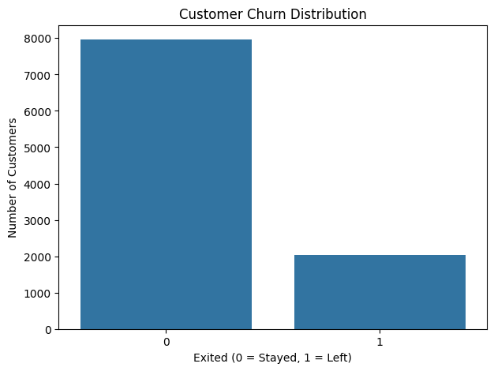
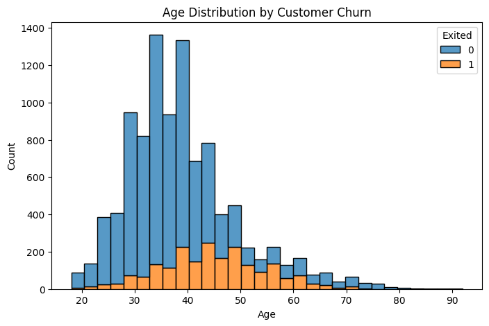
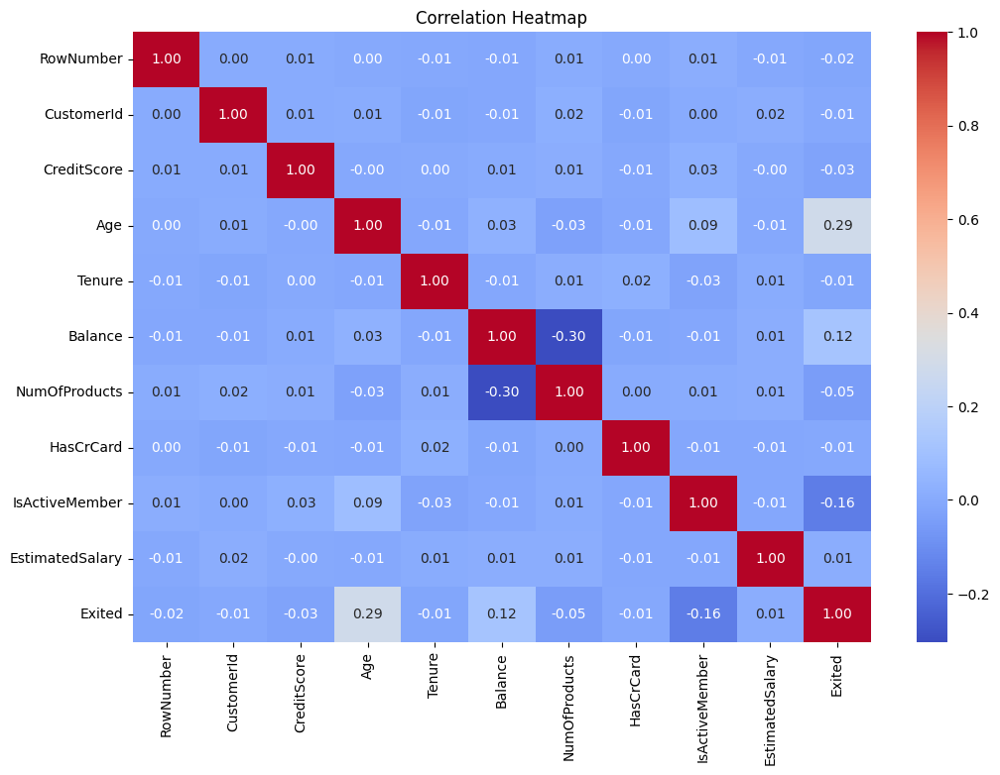
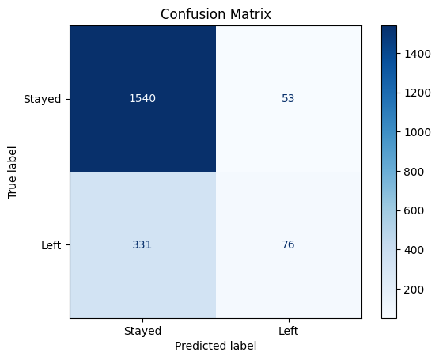

# Bank Customer Churn Prediction

## 📌 About the Project

This project focuses on predicting whether a bank customer will leave the bank or continue using its services using Machine Learning.

I used **Logistic Regression** to predict customer churn based on features like age, credit score, balance, geography and other customer details.

## 📊 Key Insights

The dataset was explored using graphs and summary statistics to understand customer behaviour.

### 1. Customer Churn Distribution

The graph shows that more customers stayed with the bank than those who left. So, the dataset is imbalanced.

### 2. Age vs Churn

This graph helps us understand how churn varies across different age groups. Age seems to be an important feature to explore.

### 3. Correlation Heatmap

The heatmap shows the relationships between numerical features in the dataset.

## 🧮 Logistic Regression

Logistic Regression is a classification algorithm used to predict one of two outcomes. Here, it predicts whether a customer will leave (`1`) or stay (`0`).

It uses the sigmoid function to convert the model's output into a probability between 0 and 1.

**Basic equation:**

\[
P(Y=1)=\frac{1}{1+e^{-z}}
\]

Where:

\[
z=b_0+b_1x_1+\cdots+b_nx_n
\]

The model uses a threshold of 0.5 to decide the final prediction.

Before training, categorical data was encoded, numerical features were scaled, and the dataset was split into 80% training and 20% testing data.

## 📈 Model Evaluation

The model was evaluated using the following metrics:

| Metric | Score |
|---|---|
| Accuracy | [Your value] |
| Precision | [Your value] |
| Recall | [Your value] |
| F1-Score | [Your value] |
| ROC-AUC | [Your value] |

- **Accuracy:** Overall percentage of correct predictions.
- **Precision:** How many predicted churn customers actually left.
- **Recall:** How many actual churn customers were correctly identified.
- **F1-Score:** Balance between precision and recall.
- **ROC-AUC:** How well the model distinguishes between customers who stayed and left.

### Confusion Matrix

It shows the correct and incorrect predictions made by the model, including false positives and false negatives.

## 💭 Conclusion

This project helped me understand the basic workflow of Machine Learning, from exploring data to training and evaluating a model.

I also understood that accuracy alone doesn't tell us everything. Metrics like precision and recall are equally important, especially when working with an imbalanced dataset.

## 🛠️ Technologies Used

Python | Pandas | NumPy | Matplotlib | Seaborn | Scikit-learn | Google Colab
